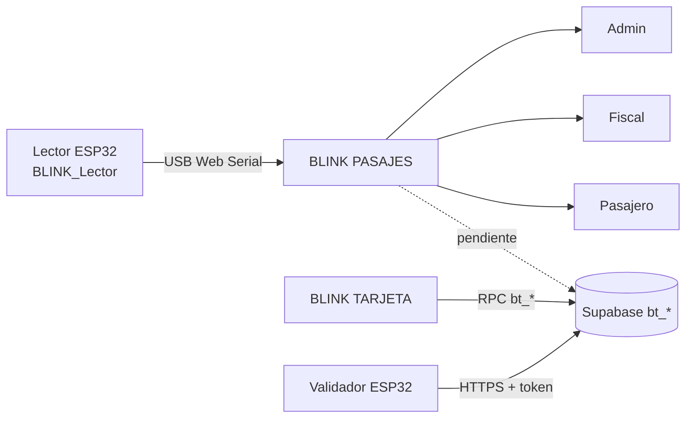

# Arquitectura de BLINK PASAJES

| Campo | Valor |
| --- | --- |
| Documento | BLINK-PAS-DOC-01 |
| Versión | 1.0.0 |
| Fecha | 2026-10-29 |
| Estado | Vigente |

## 1. Contexto

BLINK PASAJES es el panel de la línea: cobra el pasaje, aprueba recargas y rinde
cuentas. Se sirve como sitio estático en `pasajes.blink.com.ve` y se comunica con
el lector ESP32 por **Web Serial** (USB, 115200 baudios).



## 2. Capas

| Capa | Archivos | Notas |
| --- | --- | --- |
| Vistas | `src/pages/*.tsx` | Un componente por módulo, sin router externo. |
| Dominio | `src/lib/pasajes.ts`, `pasajero.ts`, `admin.ts`, `fiscal.ts` | Funciones puras y probadas. |
| Persistencia | `src/lib/datos.ts` | `localStorage` con semilla de demostración. |
| Serie | `src/lib/serial.ts` | Parser y clase `LectorSerial`. |

## 3. Protocolo del lector

| Mensaje | Significado |
| --- | --- |
| `READY,BLINK,1` | Firmware listo. |
| `CARD,<UID hex>` | Tarjeta detectada; UID de 4–20 caracteres hex. |
| `PONG` | Respuesta a un `PING`. |

El parser descarta líneas inválidas y normaliza el UID a mayúsculas. La conexión
usa `navigator.serial.requestPort()` y se abre a 115200 baudios; el canal se cierra
al desmontar la vista.

## 4. Modelo local

```ts
Tarjeta  { uid, serial, titular, cedula?, saldo, estado }
Recarga  { id, serial, monto, telefono, banco, referencia, at, estado }
Viaje    { id, serial, monto, at, unidad }
```

`datos.ts` guarda el estado en `localStorage` y expone funciones para leer,
sembrar y actualizar. La semilla incluye tarjetas y viajes de demostración para
que el panel sea usable sin backend.

## 5. Integración pendiente con Supabase

El panel debe migrar al esquema documentado en
[TARJETA › docs/04-api-rpc.md](https://github.com/BLINK-SERVERS/TARJETA/blob/main/docs/04-api-rpc.md):

| Módulo | Función de destino |
| --- | --- |
| Lector | `bt_cobrar_viaje(serial, unidad, monto)` o sincronización del validador. |
| Admin | `bt_recargas_pendientes`, `bt_aprobar_recarga`, `bt_rechazar_recarga`. |
| Fiscal | `bt_liquidar`, `bt_resumen_operativo`, `trips_telemetry`. |
| Pasajero | `bt_activar` (legado) o el flujo de cuenta de BLINK TARJETA. |

**Restricción:** las funciones de operación requieren `service_role` o un token de
validador; no pueden invocarse con la clave publishable desde el navegador. La
migración debe resolverse con un panel autenticado (Supabase Auth + RLS) o con un
servicio intermedio. Ver BLINK-DOC-09 (brecha B-03) en el repositorio TARJETA.

## 6. Decisiones

| # | Decisión | Motivo |
| --- | --- | --- |
| PD-01 | Web Serial en lugar de app nativa. | Sin instalación; funciona en Chromium de escritorio. |
| PD-02 | `localStorage` mientras no haya backend. | Permite operar y demostrar sin infraestructura. |
| PD-03 | Compilar con `base: "/"`. | El sitio sirve el dominio completo, no un subdirectorio. |
| PD-04 | Sin router. | Cuatro módulos en pestañas; menos complejidad. |
